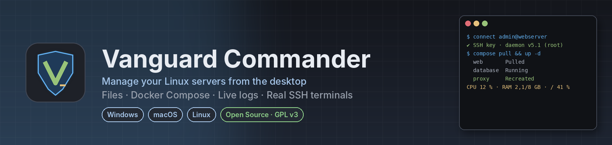

<p align="center"></p>

**Deutsch** · [English](README.md)

# Vanguard Commander 6.2.0 Beta 2

Fernverwaltung für Linux-Server: Dateien, Docker und Compose, Firewall, Live-Logs, Server-Status, mehrere SSH-Terminals.
Läuft als eigenständiges Programm unter **Windows, macOS und Linux**.

## Schnellstart (aus dem Quellcode)

```bash
python -m pip install -r requirements.txt
python run_commander.py
```

Beim ersten Start legst du ein Profil an (Host, SSH-Benutzer). Danach unter **⚙️ Einstellungen → „Schlüssel auf Server hinterlegen“** klicken:
Der Commander erzeugt bei Bedarf einen Ed25519-Schlüssel (`~/.ssh/vanguard_ed25519`), fragt **einmal** nach dem SSH-Passwort,
trägt den Schlüssel in `~/.ssh/authorized_keys` ein und testet die Anmeldung. Ab dann ist **kein Passwort mehr nötig**.

## Builds

### Erster Build (Beta)

**Windows** – im Projektordner doppelklicken oder in der Eingabeaufforderung starten:
```
build\build_windows.bat
```
Das dauert beim ersten Mal ein paar Minuten (eigene Python-Umgebung, Pakete, Tests, PyInstaller).
Ergebnis: `dist\VanguardCommander.exe` – eine einzelne Datei, die ohne installiertes Python läuft.
Unsigniert: Windows SmartScreen zeigt beim ersten Start „Der Computer wurde geschützt“ → **Weitere Informationen →
Trotzdem ausführen**. Manche Virenscanner melden selbst gebaute PyInstaller-Programme fälschlich (Fehlalarm).

**macOS** – braucht einen Mac (Apple Silicon oder Intel, macOS 10.14 oder neuer) mit Python 3.10+ von python.org.
Schritt-für-Schritt für Helfer ohne Programmierkenntnisse: `ANLEITUNG_MAC.txt`.
```
bash build/build_macos.sh
```
Das Skript wählt die Qt-Version passend zum macOS (ab 12: aktuell, 11: Qt 6.7, 10.14/10.15: Qt 6.4) und
baut für den Prozessor des Macs. Ergebnis: `dist/VanguardCommander.app` und `dist/VanguardCommander-<Version>-macOS-<arm64|x86_64>.zip`.
Unsigniert: Beim ersten Start blockiert macOS. Dann **Systemeinstellungen → Datenschutz & Sicherheit → „Trotzdem öffnen“**
(bis macOS 14 reicht auch Rechtsklick → Öffnen). Weitergeben am besten als ZIP (`ditto -c -k --keepParent …`).

**Ohne Mac:** Im GitHub-Repository unter „Actions → Build → Run workflow“ starten (Workflow: `.github/workflows/build.yml`).
Ein Tag wie `v6.2.0-beta1` erzeugt automatisch ein Release mit allen Dateien. GitHub baut dann Windows, Mac (Apple Silicon und Intel)
und Linux und stellt die Dateien unter „Artifacts“ bereit.

Programm-Symbol: `build/icons/` (Windows `.ico`, Mac `.icns`), neu erzeugen mit `python build/icons/make_icon.py`.
Die Versionsnummer steht nur in `vanguard_commander/__init__.py` (`VERSION`, `RELEASE`).

### Übersicht

| System  | Befehl (im Projektordner)        | Ergebnis                         |
|---------|----------------------------------|----------------------------------|
| Windows | `build\build_windows.bat`        | `dist\VanguardCommander.exe`     |
| macOS   | `build/build_macos.sh`           | `dist/VanguardCommander.app`     |
| Linux   | `build/build_linux.sh`           | `dist/VanguardCommander`         |

Jedes Skript legt eine eigene virtuelle Umgebung (`.venv-build`) an, führt die Tests aus und baut mit PyInstaller.
Eine Windows-Exe kann nur unter Windows gebaut werden, eine Mac-App nur auf einem Mac.
Wer nicht drei Rechner hat: GitHub baut alle drei über `.github/workflows/build.yml` (Actions → „Run workflow“).
Das ist optional und setzt voraus, dass der Ordner in ein GitHub-Repository kommt.

Die macOS-App ist unsigniert: Beim ersten Start Rechtsklick → **Öffnen**.

## Wo liegt was?

Nichts davon steht im Programmcode, deshalb kann das Programm weitergegeben werden:

| Inhalt | Ort |
|---|---|
| Profile (Host, Benutzer, Port, Lesezeichen, eigene Befehle) | `profiles.json` im Konfigurationsordner |
| Passwörter (sudo, SSH, Schlüssel-Passphrase) | `vault.bin`, verschlüsselt (AES-256-GCM, scrypt aus Master-Passwort) |
| Bekannte Server (Host-Keys) | `known_hosts` im Konfigurationsordner |
| Protokoll / Fehler | `vanguard.log` im Konfigurationsordner (max. 3 × 1 MB). Unerwartete Fehler werden dort festgehalten und angezeigt, das Programm läuft weiter |
| SSH-Schlüssel | `~/.ssh/vanguard_ed25519` (oder eigener Pfad im Profil) |
| Daemon-Secret | **nur auf dem Server** in `~/.vanguard/daemon.secret`. Der Commander liest es bei jeder Verbindung per SSH |

Konfigurationsordner: Windows `%APPDATA%\VanguardCommander`, macOS `~/Library/Application Support/VanguardCommander`,
Linux `~/.config/VanguardCommander`. Mit `VANGUARD_CONFIG_DIR` lässt sich ein eigener Ordner setzen (portabel).

### Weniger Passwort-Abfragen

* **Master-Passwort merken:** Häkchen „Auf diesem Rechner merken“ im Abfragefenster, oder **⚙️ Einstellungen → Tresor**.
  Windows nutzt dafür DPAPI (nur dein Windows-Benutzer auf diesem Rechner kann es entschlüsseln), macOS den
  Schlüsselbund, Linux `secret-tool`. Der Tresor öffnet sich dann automatisch. Abwägung: Wer an deinem
  angemeldeten Konto sitzt, kommt dann auch ohne Master-Passwort an den Tresor.
* **SSH-Agent:** Bei Schlüssel-Anmeldung versucht der Commander zuerst den Agent und fragt die Passphrase nur, wenn
  der nicht hilft. Unter Windows einmalig (PowerShell als Administrator):
  `Get-Service ssh-agent | Set-Service -StartupType Automatic; Start-Service ssh-agent`, danach als normaler Benutzer
  `ssh-add $env:USERPROFILE\.ssh\id_ed25519`. Windows merkt sich den Schlüssel dauerhaft.

Profile der alten Version (`~/.vanguard_commander.json`) werden beim ersten Start übernommen, **ohne** das alte Secret.
Die alte Datei bleibt unverändert.

## Was beim Verbinden passiert

1. SSH-Anmeldung mit Schlüssel. Ein unbekannter Server wird nur nach Bestätigung seines Fingerabdrucks aufgenommen, ein geänderter Server-Schlüssel bricht die Verbindung ab.
2. **Daemon (Server-Skript) automatisch:** Läuft auf dem Server Docker, lädt der Commander `vanguard_node_daemon.py` nach
   `~/.vanguard/` und startet ihn als Container `vanguard-node` (`--privileged --pid=host --network=host --restart unless-stopped`).
   Der Container startet nach einem Neustart des Servers von selbst. Nur bei einer neuen Daemon-Version wird er
   ersetzt. Von 6.0 auf 6.1 passiert das automatisch beim nächsten Verbinden (Daemon 5.0 → 5.1, neu: Live-Ausgabe).
3. Läuft der Daemon, arbeiten Dateien, Docker und Firewall **als root**. Neue Dateien erben den Besitzer ihres Ordners, bestehende behalten Besitzer und Rechte.
4. Ohne Docker (oder wenn der Daemon im Profil auf „Aus“ steht) läuft alles **nur über SSH** als angemeldeter Benutzer. Root-Befehle gehen dann über sudo mit dem Passwort aus dem Tresor.

Der Daemon lauscht nur auf `127.0.0.1` des Servers (Standard-Port **50105**) und wird über einen SSH-Kanal angesprochen.
Es wird kein Port freigegeben, und `ssh.exe` wird nicht gebraucht.

## Dateien

Links dein Rechner, rechts der Server. Beide Seiten sind gleich breit, ein Doppelklick auf einen Trenner stellt das wieder her. Über **💽 Laufwerke / Orte** links wählst du Laufwerke (C:, D:, USB-Sticks …)
sowie Benutzerordner, Desktop, Downloads und Dokumente. Die Liste wird bei jedem Aufklappen neu eingelesen.
Rechts gibt es pro Profil eigene Lesezeichen („➕ Aktuellen Ordner merken“, Rechtsklick entfernt).

**Drag & Drop:** Dateien und Ordner zwischen links und rechts ziehen, oder direkt aus dem Windows-Explorer bzw.
macOS-Finder auf die Server-Seite. Wird auf einer Ordnerzeile abgelegt, landet alles in diesem Ordner, sonst im
angezeigten. Von links in den Explorer ziehen kopiert lokal. Vor dem Überschreiben wird auf beiden Seiten nachgefragt.

## Docker und Compose

* **Container:** Starten, Stoppen, Neustarten, Logs, **📡 Live-Logs** (auch per Doppelklick), Image neu laden, Entfernen, Aufräumen.
* **🧩 Compose:** Beim Verbinden und mit „🔍 Suchen“ werden Compose-Dateien auf drei Wegen gefunden:
  laufende Projekte (`docker compose ls`), die Merkmale aller Container und eine Dateisuche nach
  `docker-compose.yml`, `docker-compose.yaml`, `compose.yml` und `compose.yaml` in den **Suchordnern des Profils**
  (Standard `/opt, /srv, /home, /root`, bis 5 Ebenen, ohne `node_modules`/`.git`). Suchordner und feste Dateien
  lassen sich in **⚙️ Einstellungen → Profil → Docker Compose** einstellen, „➕ Datei …“ im Docker-Reiter ergänzt ebenfalls.
  Die Container-Liste zeigt in der Spalte „Compose“, zu welchem Projekt ein Container gehört. Ein Klick auf den
  Container wählt sein Projekt oben aus. Aktionen: **Pull & Up** (neue Images laden, geänderte Container neu
  erstellen), Up, Restart, Down, Status, Logs, Logs live. Pull & Up, Up, Restart und Down zeigen ihren Fortschritt
  im Live-Fenster. Pull & Up, Restart und Down fragen vorher nach.
  Funktioniert mit `docker compose` (v2) und dem alten `docker-compose`.

## Live-Logs

Eigene Fenster, beliebig viele gleichzeitig: Container, Compose-Projekte, Daemon und Systemlog (`journalctl -f`, Seitenleiste).
Die Ausgabe lässt sich anhalten, fortsetzen und filtern, Mitlaufen kann man abschalten. Schließt du das Fenster,
wird der Befehl auf dem Server beendet.

## Server-Status

Solange eine Verbindung besteht, zeigt die Kopfzeile alle 5 s **CPU, RAM, Platte (/) und Last**.
Grün heißt in Ordnung, gelb bedeutet ab 75 %, rot ab 90 %. Die Abfrage nur liest und braucht kein root.

## Tastenkürzel (F1 im Programm zeigt die Übersicht)

| Taste | Wirkung |
|---|---|
| Strg+K / Strg+Umschalt+K | Verbinden / Trennen |
| Strg+P | Profil wählen |
| Strg+1 … 5, Strg+Bild↑/↓ | Reiter wechseln (auch aus dem Terminal heraus) |
| Strg+, | Einstellungen |
| Strg+Umschalt+P | Datenschutz-Modus 🕶️ ein/aus |
| F5 | Aktualisieren |
| Tab | Dateien: zwischen lokal und Server wechseln |
| Enter / Rücktaste / Alt+↑ | Öffnen / eine Ebene höher |
| F2 | Umbenennen (überschreibt nie) |
| F4 / Umschalt+F4 | Im Editor öffnen / neue Datei |
| Strg+→ / Strg+← | Hochladen (links → Server) / Herunterladen (Server → links) |
| F6 | Auswahl zur anderen Seite übertragen |
| F7 | Neuer Ordner |
| Entf / F8 | Löschen (lokal: Papierkorb) |
| Strg+L / Strg+F | Pfadfeld / Filter, Esc springt zurück in die Liste |
| Strg+Umschalt+C | Pfad der Auswahl kopieren |
| Alt+L | Laufwerk / Ort wählen |
| Strg+Umschalt+T / W | Neues Terminal / Terminal schließen |
| F1 | Übersicht aller Tastenkürzel |

Unter macOS steht Cmd statt Strg. Im Terminal gehen alle anderen Tasten an den Server (Strg+C, F-Tasten, Tab …).

## Datenschutz-Modus für Screenshots

Der Knopf 🕶️ oben rechts (Strg+Umschalt+P) ersetzt in der Anzeige Profilnamen, Hostnamen, IP-Adressen,
Benutzernamen und das Home-Verzeichnis durch neutrale Platzhalter (z. B. „Mein Server“, „admin“, 192.0.2.10).
Lokale Liste, Pfade und Orte werden unscharf. Das gilt auch für Terminal, Protokoll und Live-Logs.
Gespeichert und gesendet wird weiterhin das Echte – nur die Anzeige ändert sich.

## Eigene Buttons für Server-Aktionen

Unter **⚙️ Einstellungen → Eigene Befehle** legst du Buttons an. Jeder Button hat eine **Gruppe** (Abschnitt in der
Seitenleiste), einen Namen, den Befehl und zwei Schalter: **root** (über den Daemon bzw. mit sudo) und
**Rückfrage** (vor dem Ausführen bestätigen). Die bisherigen Standard-Buttons (df, free, ss) bleiben erhalten.
**📚 Aus Vorlagen** bietet rund 30 gängige Befehle zum Ankreuzen an, zum Beispiel aus den Bereichen System
(Prozesse, Dienste, Systemlog, Neustart nötig?), Wartung (Updates, Aufräumen), Docker (Speicher, Ressourcen,
Compose, Images), Netzwerk (IPs, Ports, Verbindungen) und Sicherheit (Logins, Fail2ban, Firewall).
Befehle, die etwas verändern, sind mit ⚠️ markiert und fragen nach. Mit der Spalte **Profil** erscheint ein Button
nur bei einem bestimmten Server (z. B. ein Compose-Neustart nur beim Webserver). „Alle Profile“ zeigt ihn überall.
Die Vorlagen stehen in
`vanguard_commander/presets.py` und lassen sich dort erweitern.

## Terminal

Beliebig viele Sitzungen als Unterreiter (➕ oder Strg+Umschalt+T). Rahmen und Linien von Programmen wie
whiptail, needrestart, mc oder dialog werden korrekt gezeichnet. Jede Sitzung ist eine echte interaktive Shell (PTY, xterm-256color): `sudo` fragt nach dem Passwort, `cd` bleibt erhalten, Pipes, Tab-Vervollständigung,
`nano`, `top` und `htop` funktionieren. Der Knopf **„🔑 sudo-Passwort senden“** schickt das gespeicherte Passwort an eine laufende Abfrage.
Markieren mit der Maus. Kopieren mit Strg+Umschalt+C (macOS Cmd+C), Einfügen mit Strg+Umschalt+V (macOS Cmd+V), Strg+C bricht ab wie gewohnt.
Umschalt+Bild↑/↓ oder das Mausrad blättern zurück.

## Sicherheitsmodell, ehrlich

* Wer sich per SSH als der Server-Benutzer anmelden kann, kann das Daemon-Secret lesen und hat damit root. Das ist genauso wie bei jedem Mitglied der Gruppe `docker`.
  Eine Positivliste für Befehle, wie es sie in v5 gab, schützt davor nicht (v5 erlaubte `python3`, `find` und alles unter `/home`).
* Jede Anfrage an den Daemon ist vollständig signiert (HMAC-SHA256 über alle Felder, Zeitfenster, Einmal-Nonce), ebenso jede Antwort.
* Schutz vor Versehen: `/etc/shadow`, `sudoers`, SSH-Host-Keys usw. werden nie überschrieben. `/`, `/etc`, `/usr`, `/home/<name>` und ähnliche Ordner werden nie gelöscht.
  Auf dem Server gibt es keinen Papierkorb, deshalb wird vor dem Löschen ausdrücklich nachgefragt. Lokal Gelöschtes kommt in den Papierkorb.

## Behoben gegenüber v5.2

* **Gefährlich:** Nach jedem Upload und jedem Speichern im Editor lief `chmod -R a+rX` und `chown -R <user>` auf dem *ganzen aktuellen Ordner*.
  In `/etc` hätte das `/etc/shadow` lesbar gemacht und sudo und ssh zerstört. Das ist entfernt.
* `rm` konnte ganze Systemordner löschen. Jetzt gibt es feste Sperren, die Daemon und Client gleichermaßen prüfen.
* Konsole: `sudo`, `apt`, Pipes, `;`, `>`, Variablen und `cd` gingen nicht. Lange Befehle brachen nach 20 s ab, und Fehlerausgaben verschwanden.
  HTML in der Ausgabe wurde ausgeführt bzw. verschluckt. Jetzt gibt es das echte Terminal, und Einzelbefehle laufen in einer bash mit Rückgabewert.
* Die Buttons „apt update/upgrade“ konnten nie funktionieren, weil `apt` nicht erlaubt war.
* Ordner-Uploads mit mehreren Unterordnern brachen ab, weil mehrere Befehle über eine Verbindung liefen.
* Download-Fehler wurden verschluckt, und trotzdem wurde Erfolg gemeldet. Upload-Prüfsummenfehler wurden nicht erkannt.
* Dateinamen mit Leerzeichen wurden abgeschnitten (`ls`-Auswertung). Jetzt kommt die Liste als JSON.
* Der Button „Key auf Server hinterlegen“ legte nur einen Ordner an. Jetzt wird wirklich eingetragen und getestet.
* Fünf Fehlversuche über den Tunnel sperrten 127.0.0.1 und damit alle Nutzer für zehn Minuten.
* Der Editor änderte den Besitzer bearbeiteter Systemdateien. Jetzt bleiben Besitzer, Rechte, Symlinks und Zeilenenden erhalten.
* Eigene Befehle erschienen erst nach dem Öffnen der Einstellungen. Das Bearbeiten mehrerer Profile verlor Änderungen.
* Fest eingebaute Pfade sind entfernt. Jedes Profil hat jetzt eigene Lesezeichen („➕ Aktuellen Ordner merken“).

## Tests

```bash
python -m unittest discover -s tests -v
```

39 Tests: Daemon-Protokoll Ende-zu-Ende (Signaturen, Replay, Manipulation, Shell-Funktionen, Zeitüberschreitung, Upload und Download mit
Prüfsumme, Rechte bleiben erhalten, Symlinks, Umbenennen ohne Überschreiben, Löschsperren, Live-Ausgabe mit Abbruch), Statusauswertung, Compose-Befehle und -Suche, Rahmenzeichen im Terminal, Profil-Buttons, Tresor, Master-Passwort merken (Linux-Weg), Schlüsselerzeugung, Profil-Migration.
Unter Windows werden die Daemon-Tests übersprungen, weil der Daemon nur auf Linux läuft.

## Bekannte Grenzen

* Mit rootless Docker kann der Daemon nicht auf den Host zugreifen. Dann arbeitet der Commander im Nur-SSH-Modus.
* Läuft auf dem Server noch der alte `vanguard_daemon` (v4, Port 50005), stört das nicht, weil v6 Port 50105 nutzt.
  Der alte Dienst kann bei Gelegenheit abgeschaltet werden (`sudo systemctl disable --now vanguard_daemon`).
* Programme mit Mausbedienung im Terminal (z. B. `mc` mit Maus) werden nur über die Tastatur bedient.

## Aufbau

```
run_commander.py              Startpunkt
vanguard_commander/
  config.py  paths.py         Profile und Ablageorte (ohne Secrets)
  vault.py                    verschlüsselter Passwort-Tresor
  applog.py                   Logdatei, Fehlerfang
  remember.py                 Master-Passwort merken (DPAPI / Schlüsselbund / secret-tool)
  keys.py                     Ed25519 erzeugen und auf dem Server hinterlegen
  ssh.py                      paramiko: Anmeldung, Host-Keys, exec, SFTP, Kanäle
  protocol.py                 Daemon-Protokoll v5 (Client)
  backends.py                 DaemonBackend (root) / SshBackend (Fallback)
  presets.py                  Vorlagen für eigene Buttons
  serverinfo.py               Server-Status, Compose-Befehle und -Suche (ohne Qt, testbar)
  termfilter.py               Rahmen-/Linienzeichen fürs Terminal
  deploy.py                   Daemon automatisch per Docker bereitstellen
  server/vanguard_node_daemon.py   Server-Skript (nur Standardbibliothek)
  ui/                         Oberfläche (PyQt6, Terminal mit pyte)
tests/                        Unittests
build/                        PyInstaller-Spec und Build-Skripte je System
```

## Autor

Entwickelt von **Reiner Ugele** ([@ReinerUgele](https://github.com/ReinerUgele)).
Vanguard Commander ist als Verwaltungswerkzeug für meine eigenen Server-Projekte entstanden und steht jetzt allen frei zur Verfügung.

## Lizenz

Vanguard Commander ist freie Software unter der **GNU General Public License v3.0 oder neuer** (`LICENSE`).
Du darfst es nutzen, verändern und weitergeben – Änderungen, die du weitergibst, bleiben ebenfalls frei.
Es wird **ohne jede Gewährleistung** bereitgestellt. Verwendete Fremdsoftware: `THIRD_PARTY_NOTICES.md`.
