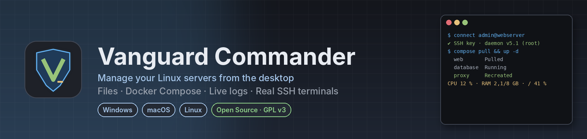
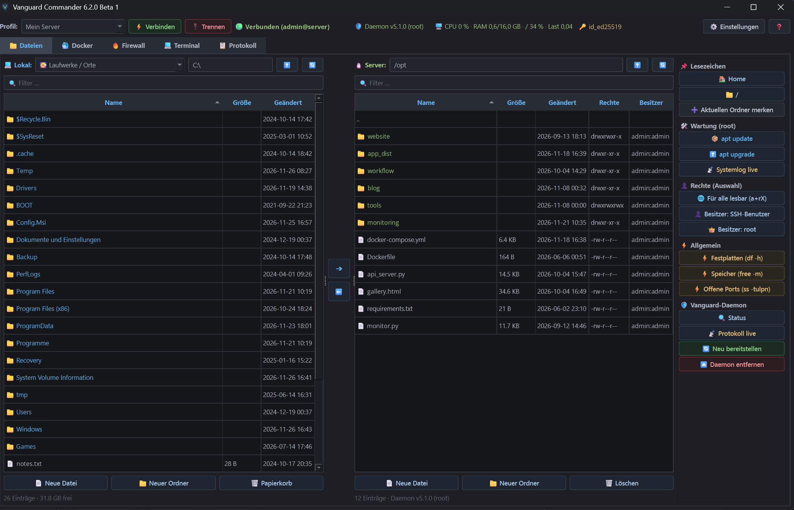
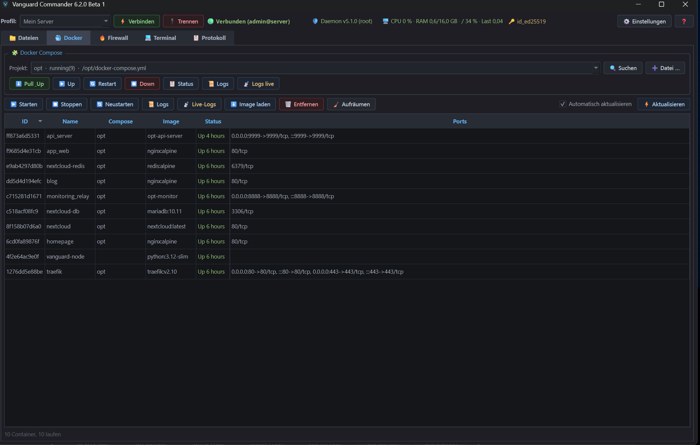
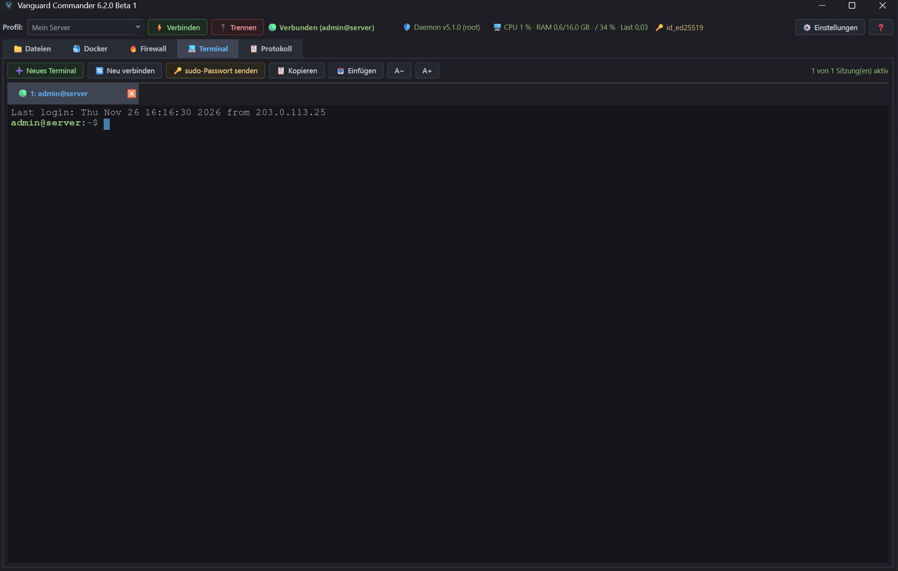
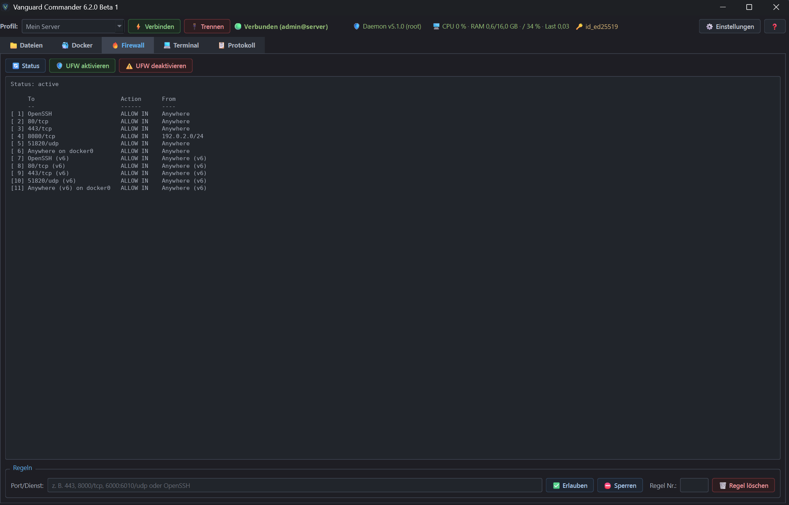
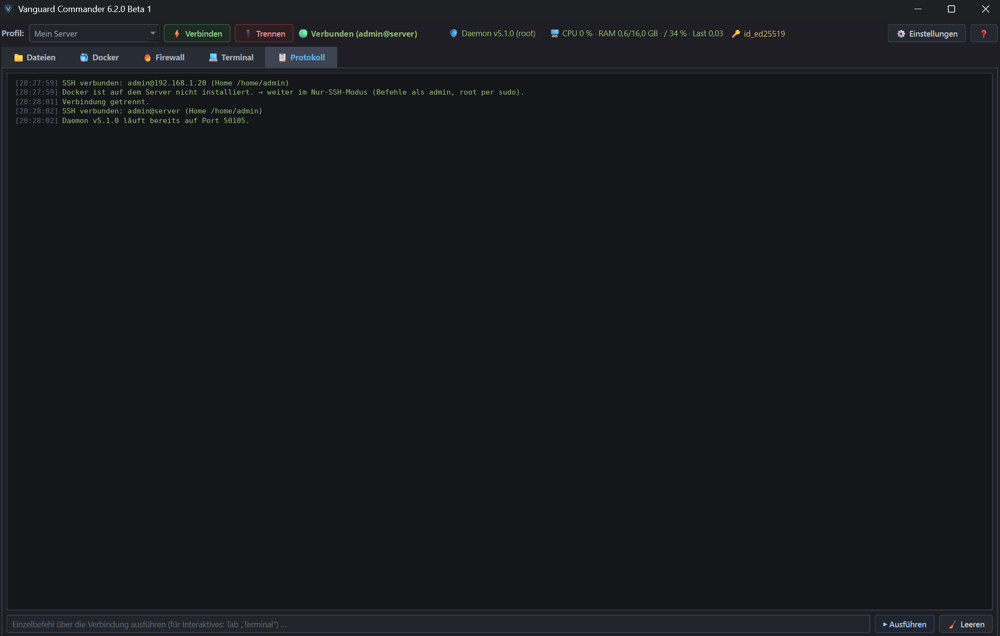

<p align="center"></p>

<p align="center">
  <a href="LICENSE"></a>
  
  
  
</p>

[Deutsch](README.de.md) · **English**

# Vanguard Commander

**A desktop app to manage your Linux servers:** dual-pane file manager, Docker & Docker Compose, live logs,
firewall and real SSH terminals – in one window, for Windows, macOS and Linux.

No web panel to expose, no agent to install by hand: Vanguard Commander connects via SSH and, if Docker is
available, deploys a small signed helper daemon on the server automatically. Without Docker it works over plain SSH.

> **Beta.** The user interface is currently **German**; an English translation is planned (help welcome!).

## Screenshots

| Files | Docker & Compose | Terminal |
|---|---|---|
|  |  |  |
| **Firewall** | **Log** | |
|  |  | |

## Features

* **SSH key login** – create an Ed25519 key and install it on the server with one click; SSH agent support
  (Windows OpenSSH agent, Pageant, macOS/Linux ssh-agent); host key pinning
* **Dual-pane file manager** – drives & places, drag & drop (also from Explorer/Finder), rename, built-in editor
  that keeps owner, permissions, symlinks and line endings; protection against deleting system directories
* **Docker** – containers with start/stop/restart, logs, **live logs**, image pull
* **Docker Compose** – projects are discovered automatically (running projects, container labels, file search in
  configurable folders); *Pull & Up*, Up, Restart, Down with live output
* **Real SSH terminals** – interactive PTY sessions in tabs: `sudo`, `nano`, `htop`, `mc`, tab completion,
  correct box-drawing characters
* **Live log windows** – containers, compose projects, systemd journal, the daemon itself
* **Server status** – CPU, RAM, disk and load in the header
* **Custom buttons** – your own server commands with groups, root flag, confirmation and per-server visibility;
  28 ready-made presets (system, maintenance, Docker, network, security)
* **UFW firewall** tab, **encrypted password vault** (AES-256-GCM) with optional "remember on this computer"
* **Privacy mode** 🕶️ (Ctrl+Shift+P) – hides server names, IPs, user names and local paths, ready for screenshots
* Keyboard driven – press **F1** for all shortcuts

## Download

Get the latest build from **[Releases](../../releases)**:

| System | File | First start |
|---|---|---|
| Windows 10/11 | `…-Windows.exe` | SmartScreen: *More info → Run anyway* (unsigned) |
| macOS 12+ Apple Silicon | `…-macOS-AppleSilicon.zip` | *System Settings → Privacy & Security → Open Anyway* |
| macOS 12+ Intel | `…-macOS-Intel.zip` | same as above |
| Linux x86_64 | `…-Linux-x86_64.tar.gz` | `chmod +x VanguardCommander && ./VanguardCommander` |

Older Macs (macOS 10.14–11): build locally with `build/build_macos.sh` – it picks a matching Qt version
(step-by-step guide in German: `ANLEITUNG_MAC.txt`).

## Getting started

1. **⚙️ Settings → Profiles → New**: host, SSH port, user.
2. **"Install key on server"**: asks once for the SSH password, installs the key, tests it – no password from now on.
3. **Connect** (Ctrl+K). If Docker runs on the server, the daemon is deployed automatically.

## How it works

```
 Desktop app ──SSH──▶ server
   │                    ├─ SFTP / shell / PTY terminals
   └─ SSH channel ─────▶├─ 127.0.0.1:50105  vanguard-node daemon (Docker container, root on the host)
                        └─ ~/.vanguard/     daemon script + secret (0600)
```

* The daemon runs as Docker container `vanguard-node` (`--privileged --pid=host --network=host`) and switches into
  the host namespaces – file operations and commands act on the host as root, without sudo prompts.
* Requests and responses are signed (HMAC-SHA256, time window, one-time nonce). Details: [SECURITY.md](SECURITY.md).
* **Honest note:** whoever can log in as that SSH user can act as root through the daemon – just like any member of
  the `docker` group. Protect the account with SSH keys.
* Without Docker (or with the daemon disabled per profile) everything works over SSH as the logged-in user;
  root commands use `sudo` with the password from the vault.

## Build from source

```bash
pip install -r requirements.txt
python run_commander.py                 # run from source
python -m unittest discover -s tests    # tests
```

Executables (PyInstaller): `build\build_windows.bat`, `build/build_macos.sh`, `build/build_linux.sh`.
GitHub Actions builds all platforms: **Actions → Build → Run workflow**; pushing a tag like `v6.2.0-beta1`
creates a release with all files attached.

Settings live outside the program folder (`%APPDATA%\VanguardCommander`, `~/Library/Application Support/
VanguardCommander`, `~/.config/VanguardCommander`) – nothing personal is compiled into the executable.

## Contributing

Issues and pull requests are welcome – see [CONTRIBUTING.md](CONTRIBUTING.md).
Security issues: please report privately, see [SECURITY.md](SECURITY.md).

## License

Vanguard Commander is free software: **GNU General Public License v3.0 or later** ([LICENSE](LICENSE)).
You may use, study, change and share it; shared modifications stay free as well.
It comes **without any warranty**. Third-party components: [THIRD_PARTY_NOTICES.md](THIRD_PARTY_NOTICES.md).

## About

Made by **Reiner Ugele** ([@ReinerUgele](https://github.com/ReinerUgele)).

Vanguard Commander started as the admin tool for my own server projects and is now free for everyone.
<!-- Platz für ein, zwei Sätze zu LUNA Centauri mit Link, sobald es eine Projektseite gibt. -->
